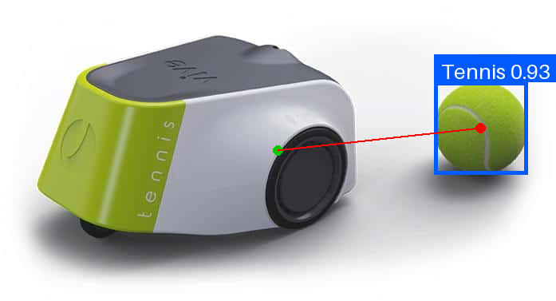
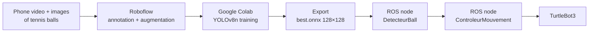
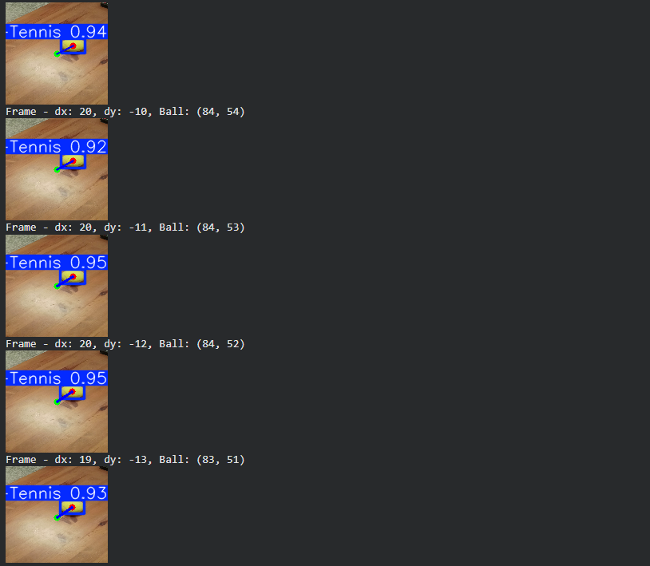
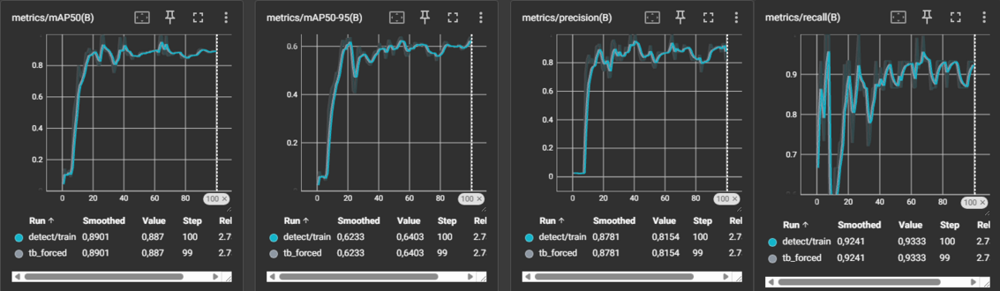
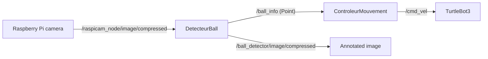

<div align="center">

# 🎾 TurtleBot3 Ball Tracking – YOLOv8 on a Robot

**A TurtleBot3 that finds a tennis ball with its camera and follows it, using a YOLOv8-nano detector trained on a custom dataset and deployed in ONNX inside ROS nodes**




<sub>The exported <code>best.onnx</code> model run on a test image: detection with 0.93 confidence, ball centre (red), image centre (green) and the horizontal error used to steer the robot.</sub>

</div>

> [!NOTE]
> 🇫🇷 **This project was carried out in French.** Node names, comments and log messages (`DetecteurBall` = ball detector, `ControleurMouvement` = motion controller, `Mode Recherche` = search mode…) are in French. This README is in English so the project can be read by a wider audience.

---

## 📖 About

First part of a project for the **Intelligence Artificielle Embarquée** (*Embedded Artificial Intelligence*) course (academic project), 4th year, embedded systems track (January 2026), carried out as a **team of two students**.

The goal: give a **TurtleBot3** the ability to **detect a tennis ball with its camera and follow it**, going through the whole embedded-AI pipeline: building a dataset, training a neural network, exporting it for a small computer, and closing the loop between perception and motion in ROS.

## 🔁 Pipeline



### 1. Dataset (Roboflow)
- Frames extracted from a video of a tennis ball filmed with a phone, plus tennis-ball images, annotated with **bounding boxes** (one class: `Tennis`).
- **Data augmentation** (rotation, zoom, brightness changes) to make the model robust to distance, lighting and orientation: **133 images** in the final version, resized to **128×128**.
- Exported in **YOLOv8 format** (`data.yaml` + labels).

### 2. Training (Google Colab, [`training/train.ipynb`](training/train.ipynb))
- **YOLOv8n** (nano: 2.7 M parameters, 6.8 GFLOPs), pretrained weights fine-tuned for 100 epochs on 128×128 images.
- Loss, precision, recall and mAP logged to **TensorBoard** at every epoch.
- Export to **PyTorch** (`best.pt`) and **ONNX** (`best.onnx`) for the robot.

### 3. Validation ([`training/detect.ipynb`](training/detect.ipynb))
The ONNX model is run frame by frame on a video to check the detection and the tracking error before going on the robot.

<div align="center">

</div>

## 📊 Results

Validation of the best checkpoint:

| Precision | Recall | mAP50 | mAP50-95 | Inference (Tesla T4) | Training time |
|---|---|---|---|---|---|
| **0.82** | **1.00** | **0.98** | **0.68** | 1.6 ms / image | ≈ 3 min |

<div align="center">

</div>

> [!IMPORTANT]
> The validation set is **small (10 images, 15 balls)**, so these numbers are encouraging but not a solid benchmark. A larger, more varied dataset (other floors, lighting, partial occlusions) would be the first thing to improve.

## 🤖 On the robot (ROS)



**`DetecteurBall`** converts each camera image to OpenCV, resizes it to 128×128, runs the ONNX model (confidence ≥ 0.5) and publishes a `geometry_msgs/Point`:

| Field | Meaning |
|---|---|
| `x` | horizontal error between the ball centre and the image centre (px) |
| `y` | bounding-box width (px), used as a **distance proxy** |
| `z` | `1` if a ball is detected, `0` otherwise |

**`ControleurMouvement`** switches between two modes:
- 🔍 **Search**: no ball, the robot rotates in place (0.3 rad/s).
- 🎯 **Tracking**: angular speed proportional to the error (ω = −0.015 · dx), and the robot moves forward at 0.2 m/s until the ball looks big enough (box width ≥ 20 px at 128×128), then stops in front of it.

On the test image above, the ball is 47 px right of the centre with a 21 px wide box: the controller would turn right at about 0.7 rad/s and stop moving forward, because the ball is close enough.

## 🚀 Usage

**Training:** open [`training/train.ipynb`](training/train.ipynb) in Google Colab (GPU runtime), set your own Roboflow API key, workspace and project, and run all cells.

**On the TurtleBot3** (ROS Noetic, camera node running):

```bash
pip install ultralytics          # YOLOv8 runtime (loads the ONNX model)
cd ~/catkin_ws/src
git clone <this-repository-url>
cd ~/catkin_ws && catkin_make && source devel/setup.bash
roslaunch suiveur_ball run.launch
```

The nodes run with their working directory set to `src/scripts/` (`cwd="node"`), where `best.onnx` is stored.

## 📁 Repository structure

```
training/
├── train.ipynb                 # dataset download, YOLOv8n training, ONNX export
└── detect.ipynb                # test of the exported model on a video
suiveur_ball/                   # catkin package
├── src/launch/run.launch       # starts both nodes
└── src/scripts/
    ├── DetecteurBall.py        # camera -> YOLOv8 -> /ball_info
    ├── ControleurMouvement.py  # /ball_info -> /cmd_vel
    ├── best.onnx               # trained model (128×128)
    └── best.pt                 # PyTorch weights
docs/                           # images used in this README
```

## 🧠 What I learned & next steps

- The full embedded-AI workflow: data collection, annotation, augmentation, training, evaluation, export and deployment.
- Choosing a model for a small computer: the nano variant, a 128×128 input and the ONNX format keep inference fast on the robot.
- Turning a detection into a control signal: the image-centre error steers the robot, and the box size gives a cheap distance estimate without a depth sensor.
- **Next steps:** a larger dataset with a bigger validation set, remembering the last ball position to search in the right direction, filtering detections to avoid oscillations, and a smooth speed profile when approaching the ball.

This project continues with **road tracking** (lane following and traffic signs on the same TurtleBot3).

## 👤 Author

**Sivaharan Kumara Segaram**, embedded systems engineering student. Project carried out with a teammate.
